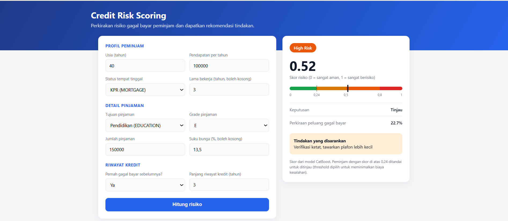

# Credit Risk Prediction & Scoring API

**English** | [Bahasa Indonesia](#bahasa-indonesia)

Predicting which loan applicants are likely to default, turning the model's score into a cost-based business decision, and serving it through a FastAPI scoring API with a simple web interface.



> Live demo: _add your Render link here_ (free tier: the first request after idle may take ~1 minute to wake up)

---

## Business problem

A lender approves loans for many applicants. Most repay, but around **21.5% default**. At application time we don't know who will default. The goal is to give every applicant a **risk score** so risky applications can be reviewed before approval, while keeping good borrowers flowing through quickly.

## Data

- Source: [Credit Risk Dataset (Kaggle, laotse)](https://www.kaggle.com/datasets/laotse/credit-risk-dataset), 32,581 loans, 12 columns
- After cleaning: 31,677 loans (impossible values removed, e.g. age > 100, employment length > 60)
- Features: borrower profile (age, income, home ownership, employment length), loan details (intent, grade A–G, amount, interest rate, loan-to-income ratio) and credit history (previous default, credit history length)
- Target: `loan_status` (0 = repaid, 1 = default)
- Evaluation approach partly inspired by the Kaggle notebook [Credit Risk Modeling: Loan Default Prediction](https://www.kaggle.com/code/qweer123/credit-risk-modeling-loan-default-prediction)

## Workflow

| Step | Notebook / file | What happens |
|---|---|---|
| 1 | `01_load_data`, `02_eda` | Explore distributions, outliers, class imbalance |
| 2 | `03_cleaning` | Remove impossible values |
| 3 | `04_feature_engineering` | Stratified 80/20 split, median imputation, encoding, scaling (fit on train only) |
| 4 | `05_train_models` | Logistic Regression and CatBoost with class weights |
| 5 | `06_evaluation` | ROC-AUC, PR-AUC, cost-based threshold, risk tiers, SHAP, calibration |
| 6 | `src/predict.py` | Reusable scoring pipeline (same preprocessing as training) |
| 7 | `api/main.py`, `web/index.html` | FastAPI scoring API and web interface |

## Results

| Metric (test set) | Logistic Regression | CatBoost |
|---|---|---|
| ROC-AUC | 0.877 | **0.943** |
| PR-AUC (baseline 0.215) | 0.732 | **0.895** |

CatBoost was selected. Train vs test ROC-AUC is 0.956 vs 0.943, so there is no meaningful overfitting.

**Cost-based threshold.** Assuming a missed default (FN) costs $500 and wrongly rejecting a good borrower (FP) costs $50, the lowest total cost is at a threshold of **0.24** instead of 0.50:

| | Threshold 0.50 | Threshold 0.24 |
|---|---|---|
| Defaults caught (recall) | 79% | **93%** |
| Precision for defaults | 81% | 46% |
| Total error cost | $157,000 | **$121,300 (−23%)** |

**Risk tiers.** Actual default rate rises consistently across tiers, so the score ranks risk well:

| Tier | Share of applicants | Actual default rate | Suggested action |
|---|---|---|---|
| Low Risk (< 0.24) | 56% | 2.6% | Fast-track approval |
| Medium Risk (0.24–0.50) | 23% | 13.6% | Standard verification |
| High Risk (0.50–0.80) | 5% | 28.0% | Strict verification, smaller limit |
| Very High Risk (≥ 0.80) | 16% | 98.9% | Reject or require collateral |

The Very High Risk tier holds only 16% of applicants but about **72% of all defaults**.

**Key risk drivers** (CatBoost importance + SHAP): loan-to-income ratio, home ownership (renters riskier, owners safer), income, interest rate and loan grade.

**Calibration.** Because of class weights, raw scores overstate the true probability. A class-weight correction brings scores closer to observed default rates (Brier score 0.0744 → 0.0558). The API returns both the raw risk score (for decisions) and the corrected probability (for communication).

## Scoring API

```bash
pip install -r requirements.txt
uvicorn api.main:app --reload
```

- Web interface: http://127.0.0.1:8000
- Interactive API docs: http://127.0.0.1:8000/docs

Example request to `POST /predict`:

```json
{
  "person_age": 30,
  "person_income": 50000,
  "person_home_ownership": "RENT",
  "person_emp_length": null,
  "loan_intent": "EDUCATION",
  "loan_grade": "C",
  "loan_amnt": 10000,
  "loan_int_rate": 13.5,
  "cb_person_default_on_file": "Y",
  "cb_person_cred_hist_length": 4
}
```

Example response:

```json
{
  "skor_risiko": 0.223,
  "perkiraan_peluang": 0.073,
  "risk_tier": "Low Risk",
  "keputusan": "Proses",
  "tindakan": "Proses otomatis / jalur cepat"
}
```

- Invalid input (e.g. age below the minimum, unknown grade) is rejected with status **422** and a clear message.
- `loan_percent_income` is computed by the API from loan amount and income.
- `GET /health` returns the API status and the active threshold.
- `python test_api.py` runs automated checks (safe applicant, risky applicant, invalid input) while the API is running.

## Project structure

```
api/main.py            FastAPI app (/predict, /health, web page)
src/predict.py         Preprocessing + scoring pipeline
web/index.html         Web interface
models/                Trained model, scaler and configs
notebooks/             Analysis notebooks 01–06
test_api.py            Automated API tests
```

## Limitations

- The $500 / $50 error costs are assumptions, not real loss data. The optimal threshold depends on them.
- The threshold was chosen and reported on the same test set, so the cost saving may be slightly optimistic. A separate validation set is the next improvement.
- Feature importance and SHAP show statistical association, not causation.
- The data is historical; the model should be monitored and retrained as borrower behaviour changes.

## Running the notebooks

Download `credit_risk_dataset.csv` from Kaggle into `data/raw/`, then:

```bash
pip install -r requirements-notebook.txt
```

and run the notebooks in order (01 → 06).

---

# Bahasa Indonesia

Memprediksi peminjam yang berisiko gagal bayar, mengubah skor model menjadi keputusan bisnis berbasis biaya, lalu menyajikannya lewat API scoring (FastAPI) dengan tampilan web sederhana.

> Demo online: _tambahkan link Render di sini_ (paket gratis: akses pertama setelah lama tidak dipakai bisa butuh sekitar 1 menit)

## Masalah bisnis

Pemberi pinjaman menyetujui pinjaman untuk banyak orang. Sebagian besar membayar lancar, tetapi sekitar **21,5% gagal bayar**. Saat pengajuan, kita belum tahu siapa yang akan gagal bayar. Tujuan project ini adalah memberi setiap peminjam **skor risiko**, supaya pengajuan berisiko bisa ditinjau sebelum disetujui, sementara peminjam yang baik tetap diproses cepat.

## Data

- Sumber: [Credit Risk Dataset (Kaggle, laotse)](https://www.kaggle.com/datasets/laotse/credit-risk-dataset), 32.581 pinjaman, 12 kolom
- Setelah dibersihkan: 31.677 pinjaman (nilai mustahil dibuang, misalnya usia di atas 100 atau lama kerja di atas 60 tahun)
- Fitur: profil peminjam (usia, pendapatan, status tempat tinggal, lama bekerja), detail pinjaman (tujuan, grade A–G, jumlah, suku bunga, rasio pinjaman terhadap pendapatan), dan riwayat kredit (pernah gagal bayar, panjang riwayat kredit)
- Target: `loan_status` (0 = lancar, 1 = gagal bayar)
- Pendekatan evaluasi sebagian terinspirasi dari notebook Kaggle [Credit Risk Modeling: Loan Default Prediction](https://www.kaggle.com/code/qweer123/credit-risk-modeling-loan-default-prediction)

## Alur kerja

| Tahap | Notebook / file | Isi |
|---|---|---|
| 1 | `01_load_data`, `02_eda` | Eksplorasi distribusi, outlier, ketidakseimbangan kelas |
| 2 | `03_cleaning` | Membuang nilai yang mustahil |
| 3 | `04_feature_engineering` | Split stratified 80/20, imputasi median, encoding, scaling (fit hanya di data train) |
| 4 | `05_train_models` | Logistic Regression dan CatBoost dengan bobot kelas |
| 5 | `06_evaluation` | ROC-AUC, PR-AUC, threshold berbasis biaya, risk tier, SHAP, kalibrasi |
| 6 | `src/predict.py` | Pipeline scoring yang bisa dipakai ulang (preprocessing sama dengan saat training) |
| 7 | `api/main.py`, `web/index.html` | API scoring FastAPI dan tampilan web |

## Hasil

| Metrik (data test) | Logistic Regression | CatBoost |
|---|---|---|
| ROC-AUC | 0,877 | **0,943** |
| PR-AUC (baseline 0,215) | 0,732 | **0,895** |

CatBoost dipilih sebagai model utama. ROC-AUC di data train 0,956 dan di data test 0,943, sehingga tidak ada overfitting yang berarti.

**Threshold berbasis biaya.** Dengan asumsi gagal bayar yang lolos (FN) merugikan $500 dan peminjam baik yang ditolak (FP) merugikan $50, total biaya terendah ada di threshold **0,24**, bukan 0,50:

| | Threshold 0,50 | Threshold 0,24 |
|---|---|---|
| Gagal bayar yang tertangkap (recall) | 79% | **93%** |
| Precision gagal bayar | 81% | 46% |
| Total biaya kesalahan | $157.000 | **$121.300 (−23%)** |

**Risk tier.** Tingkat gagal bayar aktual naik konsisten di setiap tier, jadi skor model mengurutkan risiko dengan baik:

| Tier | Porsi peminjam | Gagal bayar aktual | Tindakan yang disarankan |
|---|---|---|---|
| Low Risk (< 0,24) | 56% | 2,6% | Proses otomatis / jalur cepat |
| Medium Risk (0,24–0,50) | 23% | 13,6% | Verifikasi standar |
| High Risk (0,50–0,80) | 5% | 28,0% | Verifikasi ketat, plafon lebih kecil |
| Very High Risk (≥ 0,80) | 16% | 98,9% | Tolak atau minta jaminan |

Tier Very High Risk hanya berisi 16% peminjam, tetapi memuat sekitar **72% dari seluruh kasus gagal bayar**.

**Faktor risiko utama** (feature importance CatBoost + SHAP): rasio pinjaman terhadap pendapatan, status tempat tinggal (penyewa lebih berisiko, pemilik rumah lebih aman), pendapatan, suku bunga, dan grade pinjaman.

**Kalibrasi.** Karena memakai bobot kelas, skor asli lebih tinggi dari peluang sebenarnya. Koreksi bobot kelas membuat skor lebih dekat dengan tingkat gagal bayar aktual (Brier score 0,0744 → 0,0558). API mengembalikan skor risiko asli (untuk keputusan) dan perkiraan peluang yang sudah dikoreksi (untuk komunikasi).

## API scoring

```bash
pip install -r requirements.txt
uvicorn api.main:app --reload
```

- Tampilan web: http://127.0.0.1:8000
- Dokumentasi API interaktif: http://127.0.0.1:8000/docs

Contoh request dan response `POST /predict` ada di bagian bahasa Inggris di atas.

- Input yang tidak valid (misalnya usia di bawah batas minimal atau grade yang tidak dikenal) ditolak dengan status **422** beserta pesan yang jelas.
- `loan_percent_income` dihitung otomatis oleh API dari jumlah pinjaman dan pendapatan.
- `GET /health` menampilkan status API dan threshold yang sedang dipakai.
- `python test_api.py` menjalankan tes otomatis (peminjam aman, peminjam berisiko, dan input salah) saat API sedang berjalan.

## Batasan

- Biaya kesalahan $500 dan $50 adalah asumsi, bukan data kerugian asli. Threshold optimal bergantung pada asumsi ini.
- Threshold dipilih dan dilaporkan di data test yang sama, sehingga penghematan biaya bisa sedikit lebih optimis dari kenyataan. Perbaikan berikutnya adalah memakai data validasi terpisah.
- Feature importance dan SHAP menunjukkan hubungan statistik, bukan sebab-akibat.
- Data bersifat historis; model perlu dipantau dan dilatih ulang jika perilaku peminjam berubah.

## Menjalankan notebook

Unduh `credit_risk_dataset.csv` dari Kaggle ke folder `data/raw/`, lalu:

```bash
pip install -r requirements-notebook.txt
```

dan jalankan notebook secara berurutan (01 → 06).

---

**Author:** Nabila Karima Azka · [LinkedIn](https://www.linkedin.com/in/nabilakarima) · [Portfolio](https://nabilakarimaazka.github.io)
